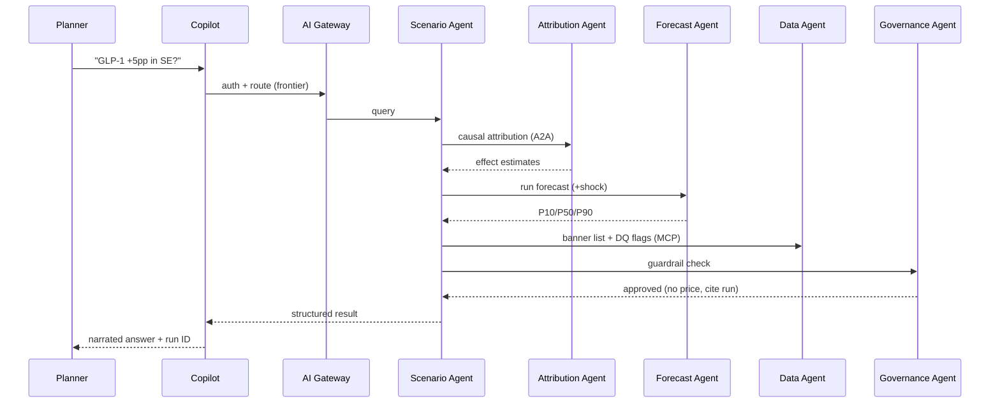

# User Journeys and Flows

## 1. Primary journey — "Monday morning scenario"

> **Planner (Teams):** "GLP-1 keeps climbing in the Southeast. If it's up 5 points by Q3, what happens to DiGiorno and Hot Pockets, and which banners should I worry about?"

1. **Copilot** (TypeScript front-end) → **AI Gateway** (Portkey): authenticates via Entra ID, checks OPA policy (planner owns Southeast + Frozen), routes to **Frontier** (complex reasoning).
2. **Scenario Agent** calls **Attribution Agent** (A2A) → causal service runs synthetic control per DMA, DiD on the adoption ramp → estimated GLP-1 effect, separable from price/distribution.
3. **Forecast Agent** runs the regime-aware forecast with GLP-1 +5pp shock, hierarchical reconciliation (MinT), returns P10/P50/P90 at store → banner → DMA.
4. **Data Agent** (MCP) pulls the banner list, contract terms, and data-quality flags (stockout censoring).
5. **Governance Agent** (NeMo Guardrails) enforces: no price recommendation, cite the forecast run ID, redact any household PII.
6. **Copilot** narrates: *"By Q3, DiGiorno units −6.2% (P10 −8.1%, P90 −4.4%) vs. plan. Concentrated in [3 banners] in [DMAs]. GLP-1 accounts for −2.1pp, price −1.3pp, distribution −0.8pp, private label −0.5pp. Run ID FR-2026-11-22-0142."*
7. **Observability:** LangSmith logs the trace, Datadog tracks latency/cost, MLflow links to the model version.

## 2. Secondary journeys

| Journey | Steps |
|---|---|
| **Nightly forecast review** | Planner opens dashboard → sees exceptions (largest deltas, low-confidence) → drills into attribution → accepts/annotates |
| **New product / reformulation** | Analyst requests analog forecast → system picks analog → planner adjusts → forecast generated |
| **Data quality issue** | Data Agent flags stockout censoring → planner sees caveat on affected stores |
| **Permission request** | Planner requests access to a new banner → OPA workflow → approval → access granted |

## 3. Flow diagram (scenario)

## 4. Error / edge flows

| Case | Behavior |
|---|---|
| Thin data (new banner) | Forecast Agent returns analog-based forecast with wide intervals |
| Stockout-censored store | Data Agent flags; planner sees caveat |
| Out-of-policy request | Governance Agent refuses with reason |
| Model drift detected | Evaluation loop alerts; forecast marked "degraded" |
| Upstream data late | Batch job waits / alerts; SLA breach tracked |