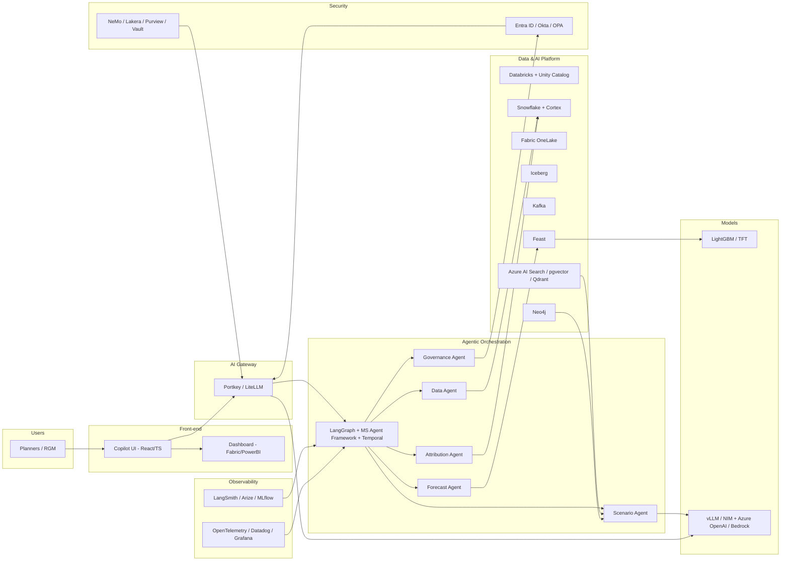

# End-to-End System Architecture

## 1. Overview

The platform is a 6-layer, agentic, permission-aware decision-support system. This document provides the end-to-end architecture; the visual companion is `01_end_to_end_system_architecture.png`.

## 2. Architecture diagram

## 3. Layer responsibilities

| Layer | Responsibility |
|---|---|
| **Users / Frontend** | Planner interaction (copilot, dashboard) |
| **AI Gateway** | Routing, semantic cache, rate limit, chargeback, fallback |
| **Agents** | Orchestrate data, forecast, attribution, scenario, governance |
| **Data & AI Platform** | Store, process, retrieve, ground |
| **Models** | Forecast (LightGBM/TFT) + LLM (extraction/narration) |
| **Security** | Identity, authorization, guardrails, DLP, secrets |
| **Observability** | Tracing, metrics, evals |

## 4. End-to-end flow (scenario)

1. Planner asks a scenario in the copilot.
2. Copilot → AI gateway (auth, route).
3. Gateway → Scenario Agent.
4. Scenario Agent → Attribution Agent (A2A) + Forecast Agent.
5. Data Agent (MCP) fetches data + quality flags.
6. Governance Agent checks policy (no price, cite run).
7. Copilot narrates grounded answer with run ID.
8. LangSmith logs trace; Datadog tracks latency; MLflow links model.

## 5. Key principles

- LLM never forecasts.
- Causal claims require causal evidence.
- Point-in-time correctness.
- Permission-aware retrieval.
- Audit every run.

## 6. Related

- `02_ui_and_micro_frontend_topology.md`
- `03_backend_and_bff_service_boundaries.md`
- `04_ai_and_ml_integration_pipeline.md`
- Platform doc set `Nestle-USA-DemandSensing-AIArchitect-UseCase/03-system-and-architecture/system-design-document.md`