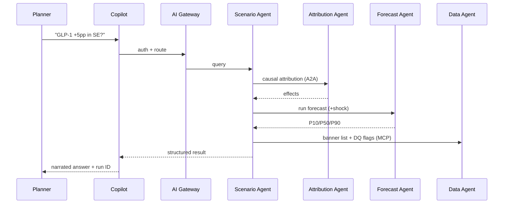
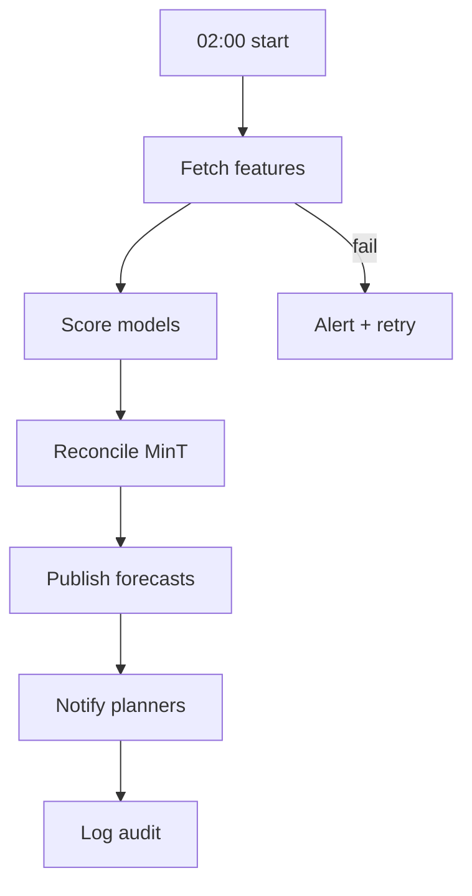

# UML Modeling and System Use Cases

Use-case, sequence, and activity diagrams for the platform. Source diagrams live in `diagrams/` (`.puml`).

## 1. Use cases

| ID | Use case | Actors |
|---|---|---|
| UC-1 | Ask a scenario what-if | Planner |
| UC-2 | Review forecasts (dashboard) | Planner, Supply planner |
| UC-3 | View causal attribution | Planner, RGM |
| UC-4 | Request data access | Planner |
| UC-5 | Run nightly forecast batch | System |
| UC-6 | Administer roles / model registry | Admin |
| UC-7 | Audit a run | Auditor |

## 2. Use-case diagram (text)

```
Planner ──▶ (UC-1 Ask scenario)
Planner ──▶ (UC-2 Review forecasts)
Planner ──▶ (UC-3 View attribution)
Planner ──▶ (UC-4 Request access)
Supply planner ──▶ (UC-2)
RGM ──▶ (UC-3)
Admin ──▶ (UC-6)
Auditor ──▶ (UC-7)
(System) ──▶ (UC-5 Nightly batch)
```

## 3. Sequence — scenario what-if



## 4. Activity — nightly batch



## 5. Diagram sources

| File | Diagram |
|---|---|
| `diagrams/class_diagram.puml` | Class / domain model |
| `diagrams/sequence_diagram.puml` | Scenario sequence |
| `diagrams/state_diagram.puml` | Run lifecycle |

## 6. Related

- `02_class_interface_and_model_definitions.md`
- `04_state_machines_and_workflow_engines.md`