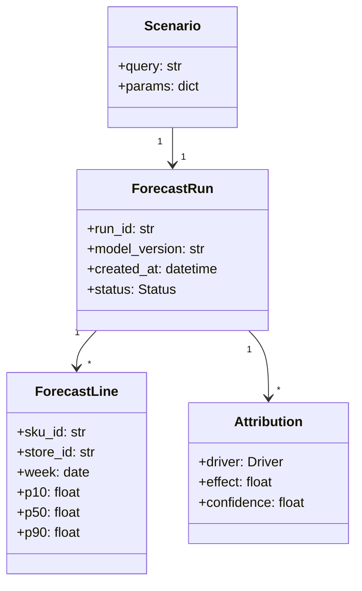

# Class, Interface, and Model Definitions

UML class diagrams, entities, DTOs, and value objects for the core domain.

## 1. Domain entities

| Entity | Attributes | Relationships |
|---|---|---|
| **ForecastRun** | run_id, model_version, created_at, status | has many ForecastLine, Attribution |
| **ForecastLine** | sku_id, store_id, week, p10, p50, p90 | belongs to run |
| **Attribution** | driver, effect, confidence | belongs to run |
| **Scenario** | query, params, result | produces a run |
| **Store / Banner / DMA** | hierarchy | — |
| **Product** | sku, brand, category | — |

## 2. Value objects

| Value object | Fields |
|---|---|
| **Interval** | p10, p50, p90 |
| **DriverEffect** | driver, effect, confidence |
| **PermissionScope** | banners, dmas, role |
| **RunId** | value (UUID) |

## 3. Class diagram (text)

## 4. DTOs

| DTO | Purpose |
|---|---|
| **ForecastRequest** | sku, store_ids, horizon, shocks |
| **ForecastResult** | run_id, forecasts, warnings |
| **ScenarioRequest** | query, context |
| **ScenarioResult** | run_id, narrative, forecast, attribution |

## 5. Interfaces / protocols

| Interface | Methods |
|---|---|
| **ForecastModel** | `predict(features) -> ForecastLine[]` |
| **AttributionStrategy** | `attribute(delta, drivers) -> DriverEffect[]` |
| **ModelRouter** | `route(task) -> ModelTier` |
| **Repository** | `get / save` |

## 6. Diagram source

See `diagrams/class_diagram.puml`.

## 7. Related

- `01_uml_modeling_and_system_use_cases.md`
- `03_design_patterns_and_principles.md`