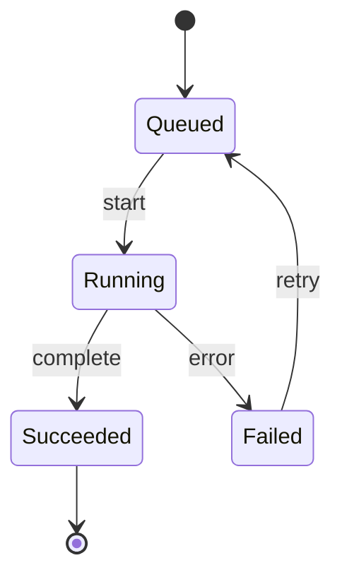

# State Machines and Workflow Engines

Finite state machines and lifecycle transitions for key domain objects.

## 1. Forecast run lifecycle



| State | Meaning |
|---|---|
| **Queued** | Waiting for a worker |
| **Running** | Scoring in progress |
| **Succeeded** | Forecasts published |
| **Failed** | Error; may retry |
| **Degraded** | Last-good served (derived) |

## 2. Scenario lifecycle

```
Requested → Authorizing → Orchestrating → Narrating → Answered
                                   ↘ Denied (OPA)
                                   ↘ Failed
```

## 3. Model promotion lifecycle

```
Candidate → Evaluating → Approved → Deployed → Verified
                         ↘ Rejected
Verified → RolledBack (on regression)
```

## 4. Data quality state

```
Fresh → Stale → Quarantined → Reprocessed
```

## 5. Workflow engine

- **Temporal** for durable long-running workflows (nightly batch, backtesting, model promotion).
- **State machines** implemented as explicit enums + transition guards.
- **Idempotent** transitions.

## 6. Transition guards

| Transition | Guard |
|---|---|
| Queued → Running | Worker available + capacity |
| Running → Succeeded | All lines reconciled |
| Running → Failed | Retry budget exhausted |
| Approved → Deployed | Eval gate passed |
| Deployed → RolledBack | Error rate > threshold |

## 7. Diagram source

See `diagrams/state_diagram.puml`.

## 8. Related

- `01_uml_modeling_and_system_use_cases.md`
- `06_reference_implementation/tests/unit/test_state_transitions.py`