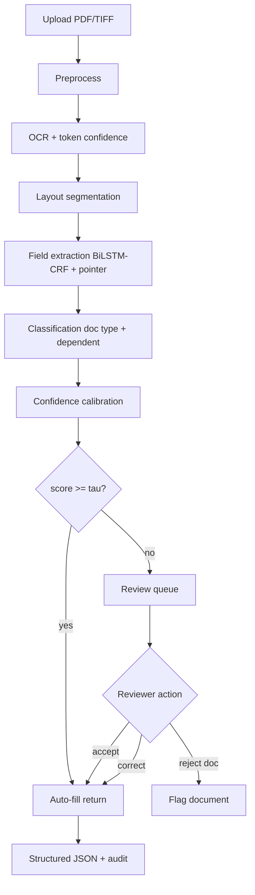

# User Journeys and Flows

## 1. Primary journey — document upload to review

1. **Upload** — Preparer uploads a PDF/TIFF (W-2, 1099, K-1, SSA-1099).
2. **Preprocess + OCR** — Deskew, denoise, binarize; Tesseract + Cloud Vision fallback; token confidence captured.
3. **Extract** — BiLSTM-CRF tags fields; pointer network copies values.
4. **Classify** — Document type; dependent category.
5. **Calibrate** — Isotonic/Platt → per-field probability.
6. **Route** — Score ≥ τ → auto-fill; score < τ → review queue.
7. **Review (if needed)** — Reviewer sees image + value + confidence + alternatives + downstream fields; accepts/corrects/rejects.
8. **Commit** — Structured JSON → return engine; audit logged.

## 2. Reviewer journey (the critical path)

**Reviewer sees:**
- Document image with the field region highlighted.
- Extracted value + calibrated confidence.
- OCR token confidence for that region.
- Suggested alternative values ranked by model score.
- The downstream return fields the value would populate.

**Reviewer actions:** accept / correct / reject-document. Every action is logged and becomes a training label.

**Efficiency requirement:** median review time per field ≤ 8 s. If review is slower than manual entry, the system has failed regardless of accuracy.

## 3. Flow diagram

## 4. Error / edge flows

| Case | Behavior |
|---|---|
| Poor scan quality | Cloud OCR fallback; lower confidence → review |
| Unknown layout | Rule-based segmentation fails → review |
| Thin profile / missing fields | "Cannot assess" → review |
| Review queue overload | Per-field thresholds tuned to keep load ≤ 0.20 |
| Confidently wrong | Tracked as category-5 error; calibration reviewed |

## 5. Feedback loop

Reviewer accept/correct/reject → training label → retrain ranker → re-validate calibration → better extraction. Closes the loop between usage and quality.