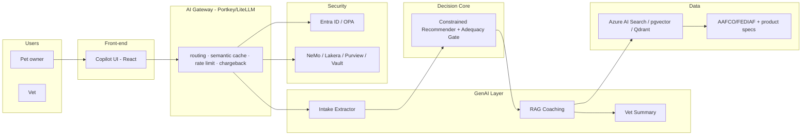

# End-to-End System Architecture

## 1. Overview

The GenAI layer sits between the owner and the decision core: it extracts a profile, calls the constrained recommender, grounds the coaching in a KB, and drafts a vet summary — all under governance.

## 2. Architecture diagram

## 3. Data flow

1. **Owner** describes pet → **Copilot**.
2. **Copilot** → **AI Gateway** (auth, OPA, route).
5. **Intake Extractor** → structured profile (JSON schema).
6. **Decision Core** (solver + adequacy gate) → plan.
7. **RAG Coaching** → retrieve KB → frontier LLM → grounding verifier → rationale.
8. **Vet Summary** → deterministic facts + LLM prose.
9. **Governance** — NeMo/Lakera/Purview enforce safety.
10. **Observability** — LangSmith/Datadog/MLflow.

## 4. Key design decision

**The LLM narrates; the solver decides.** Every number comes from the forecast/recommender; every sentence is LLM-narrated but grounded in a run the planner can audit.

## 5. Related

- `../02_tech_choices_and_adrs/architecture_decision_records/`
- `02_ui_and_micro_frontend_topology.md`
- `03_backend_and_bff_service_boundaries.md`
- `04_ai_and_ml_integration_pipeline.md`