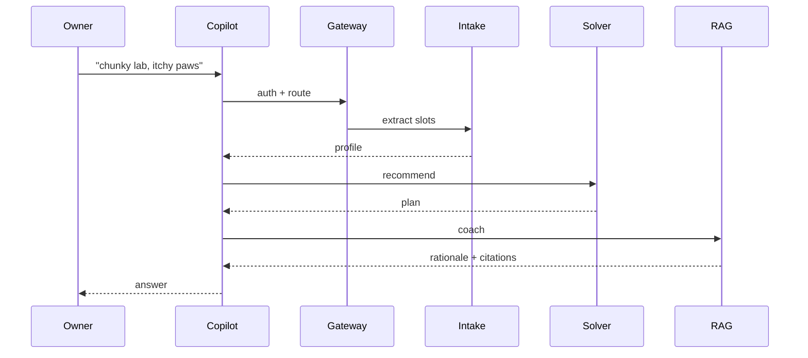
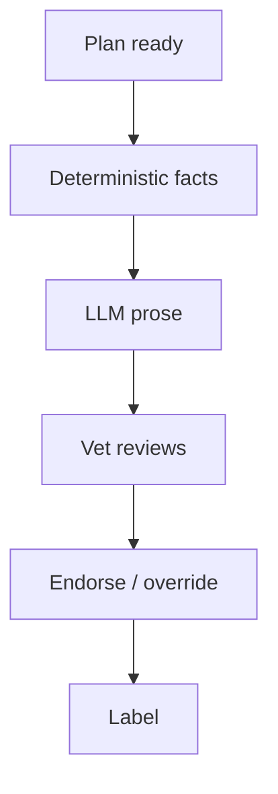

# UML Modeling and System Use Cases

## 1. Use cases

| ID | Use case | Actors |
|---|---|---|
| UC-1 | Describe pet (intake) | Owner |
| UC-2 | Get plan + coaching | Owner |
| UC-4 | Vet summary + endorse | Vet |
| UC-4 | Admin / model registry | Admin |

## 2. Sequence — intake to coaching

## 3. Activity — vet summary

## 4. Diagram sources

| File | Diagram |
|---|---|
| `diagrams/class_diagram.puml` | Class / domain model |
| `diagrams/sequence_diagram.puml` | Intake → coaching |
| `diagrams/state_diagram.puml` | Plan lifecycle |

## 5. Related

- `02_class_interface_and_model_definitions.md`
- `04_state_machines_and_workflow_engines.md`