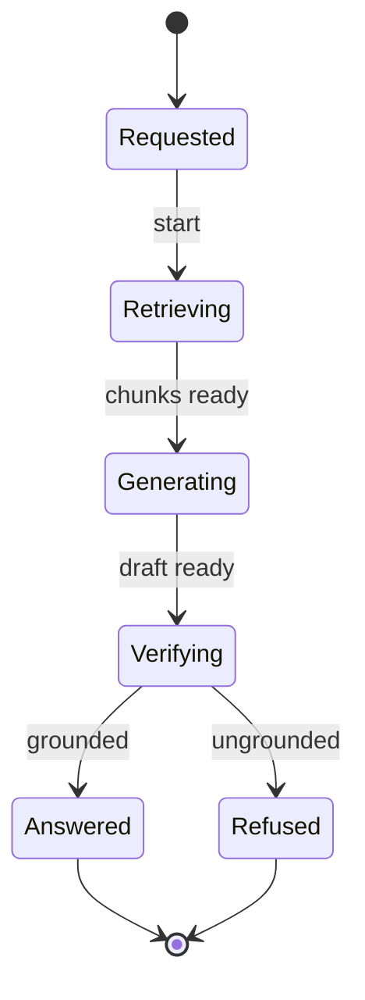

# State Machines and Workflow Engines

## 1. Coaching session lifecycle



## 2. Plan lifecycle

```
Draft → Adequate → Presented → Accepted/Adjusted → Superseded
                ↘ Rejected (inadequate)
```

## 4. Intake profile lifecycle

```
Incomplete → Partial → Complete → Used
                    ↘ Needs follow-up
```

## 5. Workflow engine

- **Temporal** for durable long-running flows (nightly eval, retraining).
- **State machines** as explicit enums + transition guards.
- **Idempotent** transitions.

## 6. Transition guards

| Transition | Guard |
|---|---|
| Retrieving → Generating | Chunks retrieved |
| Generating → Verifying | Draft produced |
| Verifying → Answered | Grounding passed |
| Verifying → Refused | Grounding failed |
| Incomplete → Complete | All required slots |

## 7. Diagram source

See `diagrams/state_diagram.puml`.