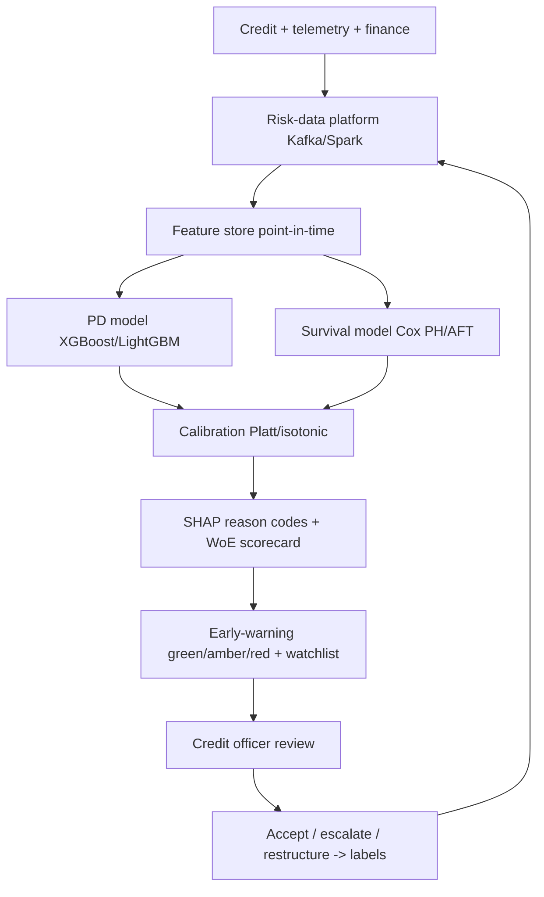

# User Journeys and Flows

## 1. Primary journey — credit officer review

1. **Overnight scoring** — risk-data platform joins credit + telemetry + finance; PD + survival models score the book.
4. **Early-warning flags** — accounts flagged green/amber/red with horizon.
5. **Credit officer** opens the watchlist; sees per account:
   - Calibrated PD + time-to-event (P10/P50/P90 months).
   - **Separated attribution:** operational vs. financial-only.
   - Top reason codes in credit language.
   - Two most similar historical accounts + outcomes.
   - Explicit horizon + confidence statement.
6. **Officer action** — accept / escalate / restructure / clear → logged as label.
7. **Governed retrain** — outcomes feed the next validated release.

## 2. Flow diagram

## 3. Error / edge flows

| Case | Behavior |
|---|---|
| Thin operational history | Reject inference; flag; don't silently bias toward tenured |
| Data-join error | Quarantine; audit join accuracy |
| Calibration drift | Alert; recalibrate |
| Concept drift (cycle) | PSI alert; retrain trigger |
| Coverage gap (new asset class) | Flag; no confident score |

## 5. Feedback loop

Officer accept/escalate/restructure/clear → outcome labels → governed retrain + recalibrate → better early warning. Every action is a training label.