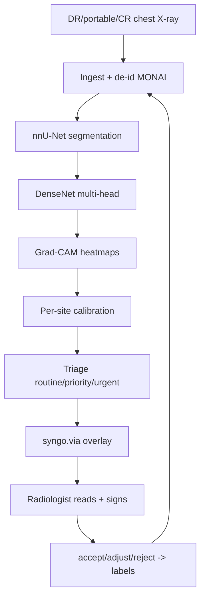

# User Journeys and Flows

## 1. Primary journey — radiologist read

1. **Acquisition** — chest X-ray (DR/portable/CR) → DICOM.
2. **Ingestion + de-id** — MONAI transforms; PHI scrub; device class captured.
3. **Inference** — nnU-Net segmentation + DenseNet classification + Grad-CAM.
4. **Calibration** — per-site/per-prevalence → site-calibrated confidence.
5. **Triage** — worklist reordered (routine/priority/urgent).
6. **Radiologist** opens study; sees:
   - Triage category + reason.
   - Heatmap overlaid, finding named in plain language.
   - Site-calibrated confidence band + suggested action.
   - Two most similar prior cases + outcomes.
   - "Cannot assess" where the model abstains.
7. **Radiologist reads + signs** — final report + action code; accept/adjust/reject → labels.
8. **Locked retrain** — feedback → next locked release.

## 2. Flow diagram

## 3. Error / edge flows

| Case | Behavior |
|---|---|
| Poor image quality | "Cannot assess" (abstain) |
| Out-of-distribution site | Flag; no confident score |
| Rare/long-tail finding | "Cannot assess"; never overclaim |
| Domain shift (portable vs. fixed) | Device-class feature; flag |
| Automation bias | Reader study measures; AI as triage not truth |

## 4. Feedback loop

Radiologist accept/adjust/reject → labels (NLP over report + microbio linkage) → locked retrain + recalibrate → better triage. Every action is a training label.