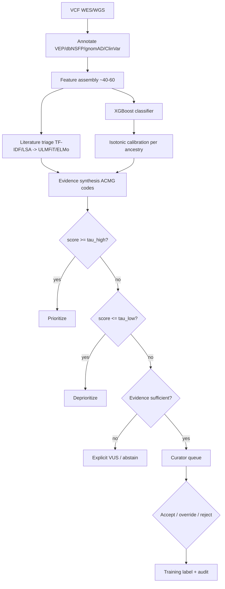

# User Journeys and Flows

## 1. Primary journey — VCF to curator decision

1. **Ingest** — Germline VCF (WES/WGS) + panel definition.
2. **Annotate** — VEP + dbNSFP + gnomAD/ExAC + ClinVar.
3. **Features** — ~40–60 interpretable features.
5. **Classify** — XGBoost/GBM → raw score.
6. **Calibrate** — per-ancestry isotonic → P(pathogenic).
7. **Literature triage** — TF-IDF/LSA → ULMFiT/ELMo relevance.
8. **Synthesize** — map signals → ACMG codes with provenance.
9. **Route** — score ≥ τ_high → prioritize; ≤ τ_low → deprioritize; between → curator queue; insufficient → explicit VUS.
10. **Curator review** — accept/override/reject → training label.

## 2. Curator journey (the critical path)

**Curator sees:**
- Variant in genomic and protein context (gene, transcript, HGVS, consequence).
- Ranked score + calibrated confidence.
- Top contributing features in plain language.
- Suggested ACMG codes, each with supporting evidence + provenance.
- Literature excerpts with relevance scores.
- Population frequencies by superpopulation.
- A visible abstention reason where applicable.

**Curator actions:** accept suggestion / override with reason / reject / mark insufficient evidence. Every action is a training label with the curator's rationale.

**Requirement:** median review ≤ 90 s. If review is slower than reading ClinVar manually, the system has failed.

## 3. Flow diagram

## 4. Error / edge flows

| Case | Behavior |
|---|---|
| Thin evidence | Explicit abstention (VUS) |
| Gene not in panel | Skip / flag |
| Stale annotation | Feature store version pin; flag |
| Confidently wrong | Category-4 error; calibration review |
| ClinVar conflict | Show both assertions + review status |

## 5. Feedback loop

Curator accept/override/reject → training label → retrain ranker → re-validate calibration → better triage. Closes the loop between usage and quality.