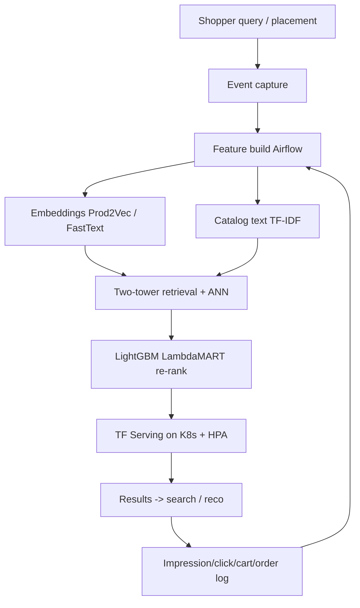

# User Journeys and Flows

## 1. Primary journey — shopper search / recommendation

1. **Shopper** searches or lands on a recommendation placement.
2. **Event capture** — query/context + user/session.
3. **Retrieval** — two-tower + ANN → top-K candidates.
4. **Ranking** — LightGBM LambdaMART re-orders.
5. **Serving** — TF Serving returns results.
6. **Results** — injected into search results / recommendation slots.
7. **Feedback** — impression/position/click/cart/order logged.

## 2. Feedback / label maturation

- Clicks and orders arrive **delayed** and are **position/exposure-dependent**.
- Labels mature on a delay; the platform treats this explicitly.
- Every impression/position/click/cart/order is logged with model version.

## 3. Flow diagram

## 4. Error / edge flows

| Case | Behavior |
|---|---|
| Cold start (new SKU) | Content/popularity fallback |
| Cold start (new user) | Context/popularity fallback |
| No results | No-results guardrail; fallback to popularity/lexical |
| Latency spike | Timeout → safe fallback (popularity/lexical) |
| Feature missing | Point-in-time defaults; flag |
| Position bias | Position recorded; bias-corrected training |

## 5. Feedback loop

Behavior (accept/ignore/convert) → mature labels → retrain candidate → shadow validation → (if approved) online experiment → deploy. Retrain produces a **candidate**, never a silent replacement.